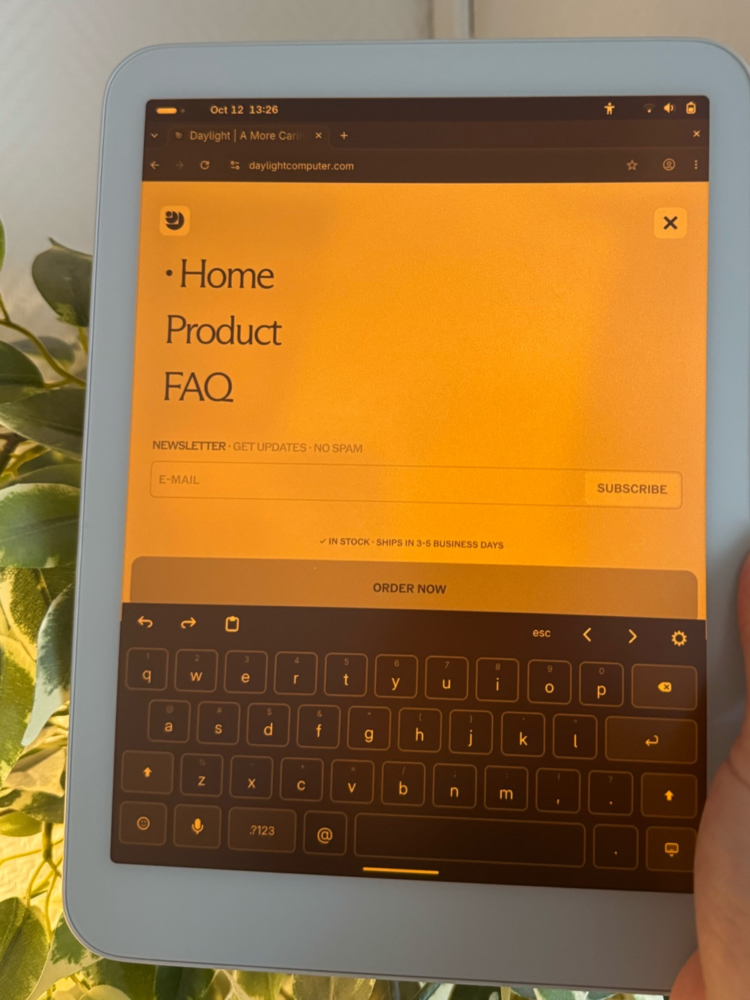

<p align="center">
  
</p>

# Daylight Apps

A small GTK/libadwaita installer for the Daylight DC-1 (Nura / postmarketOS, aarch64, musl),
modelled on Omarchy's `omarchy-install-*` / `omarchy-installed-*` / `omarchy-remove-*` scripts.

**[Latest release](https://github.com/jamesbondini/daylight-apps/releases/latest)**: what's included and how to install.

<p align="center">
  
  <br>
  <em>The Tablet Keyboard extension on a Daylight DC-1</em>
</p>

## Getting started

Run this in a terminal:

```sh
curl -fsSL https://raw.githubusercontent.com/jamesbondini/daylight-apps/main/get.sh | bash
```

It installs the dependencies (asking for your password if any are missing), downloads
Daylight Apps to `~/Projects/daylight-apps` and adds it to the app grid. Run it again to update.

### Step by step

Or do the same by hand. Install the dependencies (most are already present on Nura with GNOME):

```sh
sudo apk add git python3 py3-gobject3 gtk4.0 libadwaita
```

Download Daylight Apps and add it to the app grid:

```sh
git clone https://github.com/jamesbondini/daylight-apps.git ~/Projects/daylight-apps
cd ~/Projects/daylight-apps
./install.sh
```

Then open **Daylight Apps** from the app grid, or run `daylight-apps` in a terminal.

To update later:

```sh
cd ~/Projects/daylight-apps && git pull
```

`install.sh` links to the cloned folder, so keep it where you cloned it
(re-run `./install.sh` if you move it).

## Apps

The app shows these in the same groups, set by `CATEGORY=` in each app's `info`.

### Start Here

| App     | Installed via                                                     | Setup step |
|---------|-------------------------------------------------------------------|------------|
| Flatpak | `apk add flatpak` (password prompt) + the Flathub remote for your user | Log out and in once so Flatpak apps show in the app grid |
| Clipboard Tools | `apk add wl-clipboard` (password prompt), so terminal apps like Claude Code can copy and paste | None |

Apps with `NEEDS=flatpak` in their `info` (everything from Flathub) say “Needs Flatpak” until it is
installed, and their Install button opens the Flatpak page instead.

### Apps

Installed per user from Flathub; install Flatpak (under Start Here) first.

| App       | Flathub id                     | Setup step                                  |
|-----------|--------------------------------|---------------------------------------------|
| 1Password | `com.onepassword.OnePassword`  | Open the app and sign in                    |
| Brave     | `com.brave.Browser`            | None                                        |
| Déjà Dup  | `org.gnome.DejaDup`            | Open the app and choose what to back up and where |
| LocalSend | `org.localsend.localsend_app`  | None                                        |
| Obsidian  | `md.obsidian.Obsidian`         | Open the app and pick a vault               |

Brave also gets `/etc/brave/policies/managed/daylight-apps.json`, turning off Rewards, Wallet,
VPN, Leo, News and telemetry (Brave Origin has no musl build).

### Developer Tools

| App         | Installed via                                                        | Setup step                              |
|-------------|----------------------------------------------------------------------|-----------------------------------------|
| Claude Code | Official native installer (`claude.ai/install.sh`, arm64-musl) + `libgcc libstdc++ ripgrep wl-clipboard` | Opens `claude` in a terminal to sign in |
| Crash Helper | Systemd user service following systemd-coredump, plus `crash-diagnose`, `crash-mute` and a `diagnose-crash` skill for Claude Code (needs Claude Code) | None; “Diagnose Last Crash” opens the latest |
| Neovim      | Flathub `io.neovim.nvim` + an `nvim` command in `~/.local/bin`        | Opens `nvim` in a terminal              |
| VS Code     | Flathub `com.visualstudio.code`                                       | None                                    |

Crash Helper, after Omarchy's crash capture: when one of your programs crashes, a notification
offers to diagnose it. Tapping it opens Claude Code in Console with the crash details and the
`diagnose-crash` skill, which reads the core dump, journal and package history and reports what
happened. `crash-diagnose <pid>` does the same for any crash in `coredumpctl list`;
`crash-mute <program>` silences one program (`crash-mute <program> off` to undo).

### Services

| App       | Installed via                                                          | Setup step                                   |
|-----------|------------------------------------------------------------------------|----------------------------------------------|
| Maestral  | Python venv in `~/.local/share/maestral-venv` + systemd user service   | Link Dropbox account (opens a terminal)      |
| Tailscale | `apk add tailscale tailscale-systemd` (password prompt)                | `tailscale up`; login link shows as a button |

### Extensions

GNOME Shell extensions bundled in `extensions/`, each with an on/off switch. Log out and in
after installing one for the first time.

| App                  | What it does |
|----------------------|--------------|
| AirPods              | Quick Settings tile showing battery per AirPod and case, listening mode, adaptive level, Conversation Awareness and One-Bud ANC; pauses media when you take them out. Talks to the AirPods directly over a BlueZ L2CAP socket, using the protocol reverse-engineered by [librepods](https://github.com/kavishdevar/librepods) / [omarchy-pods](https://github.com/MB-JAMBON/omarchy-pods); no daemon. "Pair AirPods" opens Bluetooth settings |
| Hardware Buttons     | Gives the two programmable buttons (`XF86Launch1`, `XF86Launch2`) one action for a press and one for a hold, picked on the app's page: an app, Overview, screenshot, voice typing, dark style, a command and more. Takes them over from GNOME Shell's own shortcuts and gives them back when turned off |
| Maximize New Windows | Opens new windows maximized, see [dc-1-pmos#10](https://github.com/denysvitali/dc-1-pmos/issues/10) |
| Tablet Keyboard      | iPad-style on-screen keyboard. Follows the GNOME input source and adds an Esc/Tab/Ctrl/arrows row in terminals; hold the hide key for settings (height, split keyboard, autocorrect) |
| Two-Finger Scroll    | Dragging two fingers over Ghostty, Console or another terminal scrolls it like a touchpad, with momentum |
| Voice Typing         | Add-on for Tablet Keyboard: `apk add whisper.cpp` + a `dictate` helper that adds a microphone key (hold to talk, or tap to start and stop). Nothing is downloaded until you pick a model from the Speech Models list, which shows the space they use and lets you remove each one: Whisper base.en (English, recommended, 148 MB), multilingual Whisper tiny, base or small (99 languages, 78–488 MB) or Parakeet 0.6B v3 (25 European languages, recommended, 416 MB, or 669 MB at higher precision). Downloads are checked against their SHA-256, and the mic key shows their progress. The keyboard settings pick the model, a fixed language for multilingual Whisper, and a battery saver that uses the efficient CPU cores. The list lives in `apps/voice-typing/models`. "Try It" records in a terminal |
| Window Gestures      | iPad-style gestures. Swipe four fingers left or right to switch to the next or previous window on the workspace, in the order they were opened; the window follows your fingers with its neighbour sliding in beside it, and lifting past a quarter of the screen (or flicking) switches. Pinch five fingers together to close the window under them; it shrinks as you pinch and springs back if you don't pinch far enough |

## Adding an app

Create `apps/<id>/` (or `~/.config/daylight-apps/apps/<id>/`) containing:

- `info`: `NAME=`, `SUMMARY=`, `ICON=` (space-separated icon names, first found wins),
  `CATEGORY=` (`setup` for Start Here, `apps`, `developer`, `services` or `extensions`; defaults to `apps`),
  optional `WEBSITE=`, `BASED_ON=` (shown as "Based on …" for our own code modelled on another project), `SETUP_LABEL=`, `OPEN=` (desktop id or URL), `OPEN_LABEL=`
- `install`: installs or updates (also used for **Update**)
- `installed`: exit 0 when installed; first line of stdout is shown as status
- `remove`: uninstalls
- `setup` (optional): post-install step. Call `require_terminal "$0"` if it needs keyboard input.
- `enabled`, `enable`, `disable` (optional, together): exit 0 when turned on, turn on, turn off.
  These add an on/off switch to the app's row and page; the GNOME Shell extensions use them.
- `page.py` (optional): a Python module whose `build(window)` returns a GTK widget (or `None`) shown on the
  app's page while it is installed, for settings like those of `apps/hardware-buttons/`.
- `extras`, `extra-add`, `extra-remove` (optional, together): optional parts such as models. `extras` prints one `ID|Title|Subtitle|yes-or-no` line per part (yes when present), plus optionally one line without `|` that is shown under the group title (e.g. the space the parts use); the page lists them under `EXTRAS_TITLE` (from `info`) with Download and Remove buttons that run `extra-add ID` and `extra-remove ID`.

Scripts source `lib/common.sh` for `step`, `info`, `fail`, `as_root` (one polkit prompt per
call), `apk_present`, `apk_add_cmd`/`apk_del_cmd`, `flatpak_install_app`/`flatpak_status`/
`flatpak_remove_app`, `gnome_ext_set_enabled`, `gnome_ext_enabled`, `in_terminal` and `require_terminal`.
A Flathub app needs only three one-line scripts; see `apps/localsend/`. So does a GNOME Shell
extension without settings, using `gnome_ext_install`/`gnome_ext_installed`/`gnome_ext_enable`/
`gnome_ext_remove`; see `apps/window-gestures/`.
Every script also works directly from a terminal, e.g. `apps/tailscale/install`.
URLs printed by a script become clickable buttons in the app.

## License

MIT, see [LICENSE](LICENSE).
